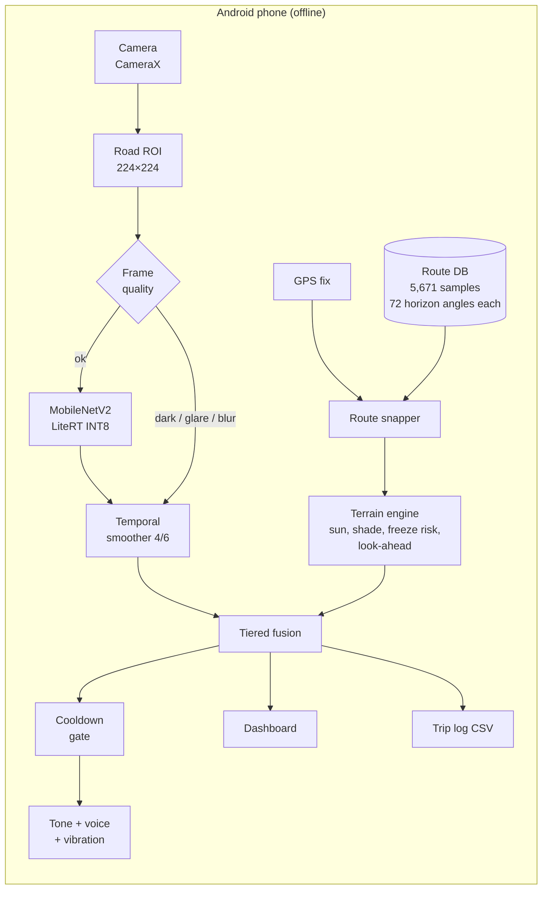
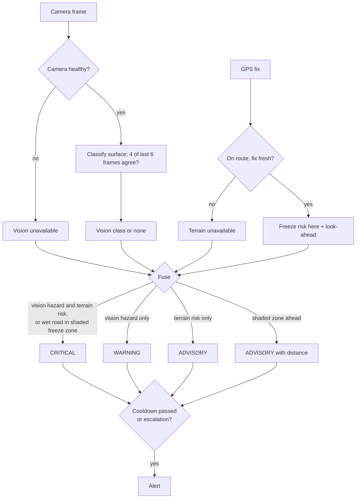
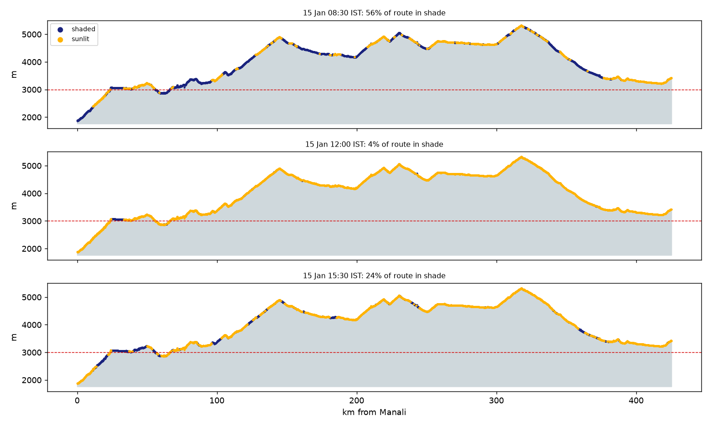
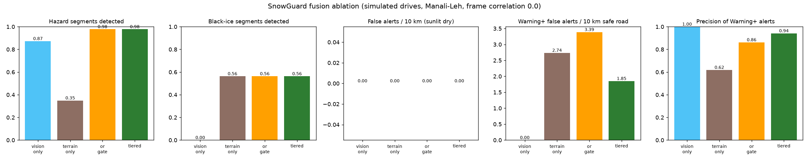
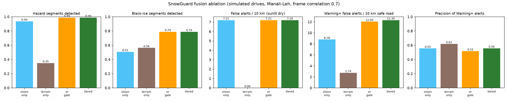

# SnowGuard

Offline, hands-free road-hazard warnings for the Manali–Leh highway.

SnowGuard is an Android app that watches the road through the phone camera and
warns the driver about ice, snow, slush, standing water and likely black ice. It
combines two independent signals, entirely on the phone and with no network:

- **Vision:** a MobileNetV2 classifier trained on RSCD labels the road surface
  ahead about 14 times a second.
- **Terrain:** a precomputed model of the 425 km corridor knows, for any GPS
  position and time, whether the road is in the sun or in mountain shadow, how
  long it has been shaded, and whether it is above the freeze altitude for the month.

The two are fused into tiered alerts (Advisory, Warning, Critical) delivered by
tone, voice (English or Hindi) and vibration, so the driver never has to look at
the screen.

> **Safety disclaimer.** SnowGuard is a research prototype and a driver aid only.
> It can miss hazards and can raise false alarms. It cannot see black ice; it
> infers the risk. Always drive to the conditions you see, follow local advisories,
> and never interact with the phone while driving.

## Features

| Feature | What it does |
|---|---|
| Surface classification | 6 classes (dry, wet, water, fresh snow, melted snow, ice), 2.4 MB INT8 model, temporal smoothing (4 of the last 6 confident frames) |
| Terrain freeze risk | Sun position (NOAA algorithm, within 0.27° of NREL SPA), DEM horizon shading, altitude–month freeze thresholds, north-facing slopes, time spent in shade |
| Tiered fusion | Terrain only → Advisory; vision only → Warning; both, or wet road in a shaded freeze zone (black-ice signature) → Critical. An OR-gate mode is kept for comparison |
| Look-ahead | Warns about shaded freeze-prone stretches 200–500 m ahead (speed × 30 s) and flags those starting on a blind corner |
| Hands-free alerts | Distinct tones per hazard and severity, offline text-to-speech in English and Hindi, vibration patterns, per-hazard cooldowns so repeats do not nag |
| Keeps running with the screen off | Foreground service holds GPS, terrain, fusion and alerts. Falls back to terrain-only when the camera is unavailable and to vision-only when GPS is lost |
| Camera health | Detects dark, glare and blurred frames and stops trusting vision until the image recovers |
| Adaptive frame rate | Fewer inferences when parked or when the phone is getting hot |
| Trip log | Every alert and state change written to CSV, shareable from settings |
| Demo drive | Replays km 120–154 on a simulated 15 January morning at 4× speed, for demos away from the route |

## How it works





## Results

### Vision model

Held-out test set of 11,860 images from drives not seen in training. Full details
are in the [model card](ml/MODEL_CARD.md).

| Model | Size | Accuracy | Ice recall | Fresh-snow recall | Ice predicted as dry or wet |
|---|---|---|---|---|---|
| float32 | 8.5 MB | 83.9% | 83.9% | 92.7% | 8.1% |
| **Shipped: dynamic INT8** | **2.4 MB** | **82.7%** | **86.7%** | **91.5%** | **4.8%** |

The BRD target of 85% accuracy is not met. The gap is almost entirely dry ↔ wet ↔
water confusion; hazard-level recall (any hazard class versus dry or wet) is 95.3%.

These figures are without class bias. Phone field tests showed dry roads being
read as wet or water, so the app ships with a hand-tuned bias towards dry (see
the [model card](ml/MODEL_CARD.md#class-bias-field-calibration)). This reduces
false alarms at the cost of some sensitivity to real hazards.

### Terrain engine

| | |
|---|---|
| Route | 425.2 km, 5,671 samples every 75 m, 9.4 km of tunnels, 1,866–5,327 m elevation |
| Horizons | 72 directions per sample, up to 20 km, from the Copernicus 30 m DEM |
| Solar accuracy | Max error 0.26° in elevation and 0.04° in azimuth against pvlib's NREL SPA |
| Winter shade (15 Jan) | 56% of the road shaded at 08:30, 4% at 12:00, 24% at 15:30 |



### Fusion ablation (BRD Objective 4)

Simulated drives over the real route database, using the real horizons, sun
positions and the shipped model's test confusion matrix, through the app's own
smoother, fusion rules and cooldowns. Nine scenarios (January, April and July;
06:00, 09:00 and 13:00 starts) × 3 seeds. Road-surface ground truth is drawn from
stated priors (see `terrain/out/ablation/ablation_report.json`), so the numbers
compare designs rather than predict field performance. Two settings bracket how
much camera errors persist across neighbouring frames.

| | Camera only | Terrain only | OR gate | Tiered |
|---|---|---|---|---|
| Hazard stretches detected | 87–94% | 35% | 98–99% | 98–99% |
| Black-ice stretches detected | 0–51% | 56% | 56–79% | 56–79% |
| Warning-or-higher false alerts / 10 km (independent errors) | 0 | 2.7 | 3.4 | **1.9** |
| Precision of Warning-or-higher alerts (independent errors) | 100% | 62% | 86% | **94%** |

Fusion catches far more hazards than either layer alone, including black ice the
camera cannot see. Tiered fusion keeps the OR gate's detection while cutting loud
false alarms by about 45%. When camera errors persist across frames, vision false
alarms on sunlit dry road rise to about 7 per 10 km for every design that uses
the camera, and tiered fusion's advantage narrows to Critical alerts being right
73% of the time.




## Install the app

1. On an Android 10+ phone, download `SnowGuard-1.0.0.apk` from the
   [Releases page](https://github.com/krushna0403/snowgaurd/releases).
2. Open it and allow installing from that source. If Play Protect warns, choose
   **More details → Install anyway**.
3. Grant **Camera**, **Location (precise)** and **Notifications**.
4. Mount the phone on the windscreen with the camera seeing the road ahead. The
   box on screen shows the area the model looks at.

Away from the Manali–Leh road the GPS chip shows "off route"; use
**Settings (⚙) → Demo drive** to see the terrain layer and alerts in action.
Everything works in airplane mode.

## Build from source

### Android app

Requirements: Android Studio (or JDK 17+ and the Android SDK with platform 35).

```bash
cd android
./gradlew assembleDebug          # app/build/outputs/apk/debug/app-debug.apk
./gradlew testDebugUnitTest      # 45 unit tests
```

Release signing is optional. Create `android/keystore.properties` with
`storeFile`, `storePassword`, `keyAlias` and `keyPassword`, then run
`./gradlew assembleRelease`. Without that file the release APK is left unsigned.

The model (`snowguard_mnv2.tflite`, `labels.json`) and the route database
(`route_manali_leh.db`) are already in `android/app/src/main/assets/`.

### Vision model (training and export)

Both steps run as Kaggle notebooks with the RSCD dataset attached:

1. `ml/notebooks/snowguard_phase1_training.ipynb` (GPU, about 2.5 hours) trains
   the model and writes metrics, confusion matrices and Grad-CAM.
2. `ml/notebooks/snowguard_phase2_export.ipynb` (CPU) converts fp32, fp16,
   dynamic INT8 and full INT8, scores them, and selects the app model.

Locally:

```bash
cd ml
python -m venv .venv && .venv/Scripts/activate      # or source .venv/bin/activate
pip install -e .
snowguard-train --data-root <RSCD>/train --output-dir runs/my_run --mixed-precision
snowguard-export --model runs/my_run/snowguard_mobilenetv2.keras \
    --manifest runs/my_run/manifest.csv --out runs/my_export \
    --android-assets ../android/app/src/main/assets
```

### Route terrain database

```bash
cd terrain
pip install -e ".[validate]"
snowguard-build-route --android-assets ../android/app/src/main/assets
snowguard-validate-solar
snowguard-ablation --confusion ../ml/runs/my_export/metrics_tflite_dynamic_int8.json
```

The builder downloads the route from OSRM, tunnels and landmarks from Overpass,
and Copernicus DEM tiles. All are cached in `terrain/data/`.

## Repository layout

```
android/    Kotlin app: camera + vision, terrain engine, fusion, alerts, service, UI
ml/         Training, evaluation, Grad-CAM and TFLite export (Python, TensorFlow)
terrain/    Route database builder, solar validation and fusion ablation (Python)
docs/       Figures and reports referenced by this README and the model card
```

## Limitations

- **Black ice is inferred, not seen.** It looks like wet road, so it is flagged
  only when the camera sees wet road in a terrain-predicted shaded freeze zone, or
  as a terrain Advisory. Black ice in unexpected places (melt-water refreezing on
  a sunlit bend) can be missed.
- **Domain shift.** The model was trained on RSCD, recorded on Chinese roads with
  a vehicle camera. In phone tests it read dry road as wet or standing water,
  especially in flat light and on footage filmed off a screen. A hand-tuned class
  bias reduces this, at the cost of detecting real wet, water and snow less
  readily. Fine-tuning on real phone footage is the proper fix.
- **Accuracy below target.** 82.7% against the 85% target; see the model card.
- **False alarms.** If camera errors persist over several frames, the ablation
  suggests up to about 7 false vision alerts per 10 km on sunlit dry road.
- **Terrain model.** Freeze thresholds are seasonal altitude rules, not weather.
  The app does not know about recent snowfall, temperature or road clearing.
- **Route only.** Terrain features cover the Manali–Leh corridor; elsewhere the app
  runs vision-only.
- **Device testing.** Latency, sustained frame rate and battery draw are still
  being measured on phones.
- **Hindi voice** needs the Hindi text-to-speech voice installed on the phone;
  otherwise alerts are spoken in English.

## Data and licences

All resources are free to use. Project code and model weights are released under
the [MIT licence](LICENSE).

| Resource | Use | Licence / terms |
|---|---|---|
| [RSCD](https://www.kaggle.com/datasets/cristvollerei/rscd-dataset-1million) | Training data (not redistributed) | Research dataset; see the dataset page for terms |
| MobileNetV2 ImageNet weights (Keras) | Pre-trained backbone | Apache 2.0 |
| [Copernicus DEM GLO-30](https://spacedata.copernicus.eu/collections/copernicus-digital-elevation-model) | Elevation and horizons in the route database | Free licence with attribution: © DLR e.V. 2010–2014 and © Airbus Defence and Space GmbH 2014–2018, provided under COPERNICUS by the European Union and ESA |
| OpenStreetMap via [OSRM](https://project-osrm.org/) and [Overpass](https://overpass-api.de/) | Route geometry, tunnels, landmarks | ODbL, © OpenStreetMap contributors. The route database is a derived database under ODbL |
| NOAA solar position algorithm | Sun position in the app | Public domain |
| TensorFlow / LiteRT | Training, conversion, on-device inference | Apache 2.0 |
| AndroidX (CameraX, AppCompat, Core), Material Components | Android app | Apache 2.0 |
| Kotlin | Android app | Apache 2.0 |
| NumPy, SciPy, scikit-learn, Matplotlib, rasterio, requests, pvlib | Python pipeline | BSD-style / PSF / Apache 2.0 |
| Kaggle Notebooks | Training and export compute | Free tier |
