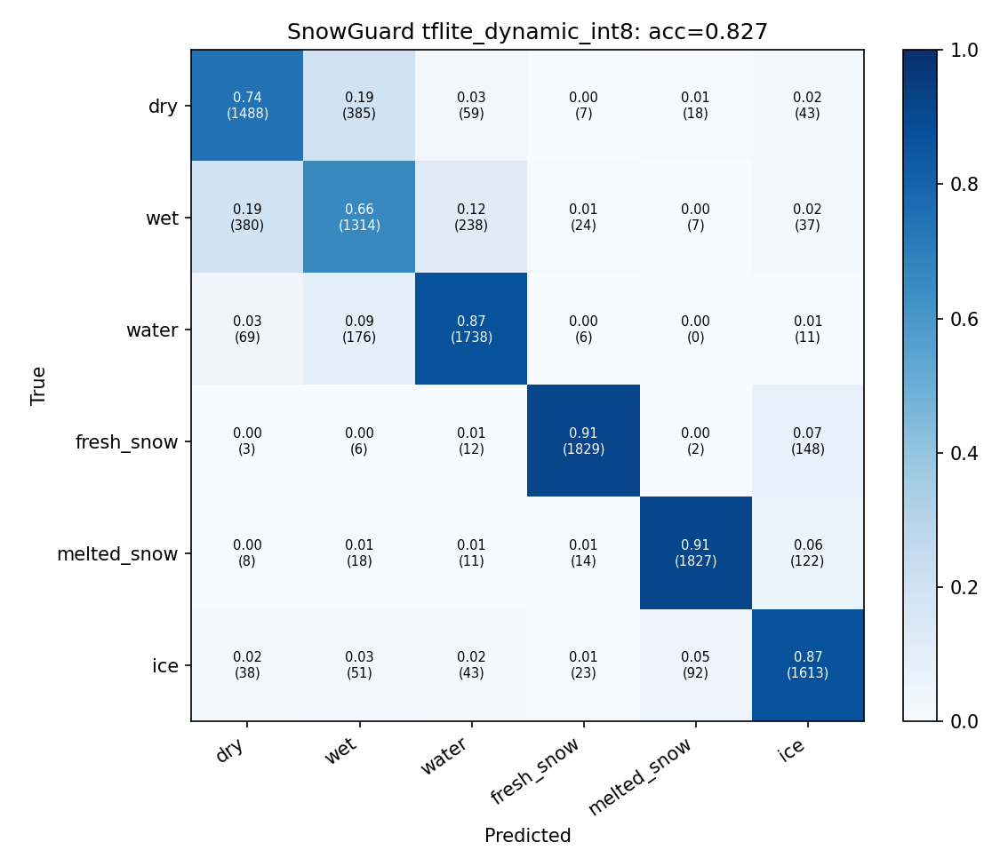
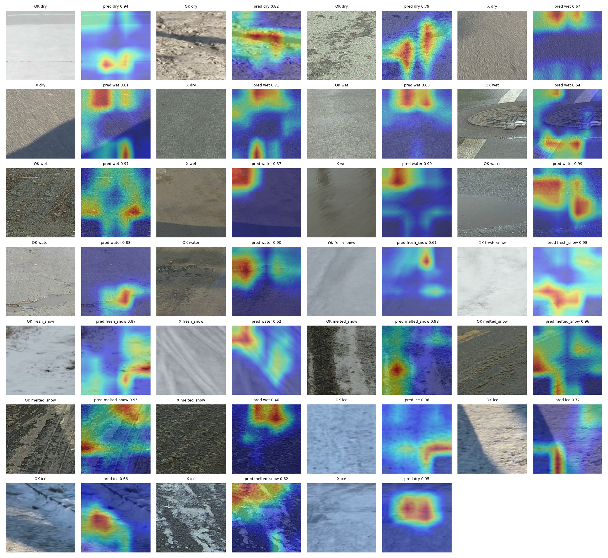

# Model card: SnowGuard road-surface classifier

## Summary

| | |
|---|---|
| Architecture | MobileNetV2 (ImageNet weights) + global average pooling + dropout 0.3 + 6-way softmax |
| Input | 224 × 224 RGB, float32, pixel range 0–255 (preprocessing is inside the graph) |
| Output | Probabilities over `dry, wet, water, fresh_snow, melted_snow, ice` |
| Shipped file | `android/app/src/main/assets/snowguard_mnv2.tflite`, dynamic-range INT8 (INT8 weights, float activations), 2.4 MB |
| Other exports | float32 Keras (`snowguard_mobilenetv2.keras`), TFLite fp32 (8.5 MB), fp16 (4.3 MB), full INT8 (2.6 MB); published on the GitHub Releases page |
| Training code | `ml/snowguard_ml/` and `ml/notebooks/snowguard_phase1_training.ipynb` (Kaggle, GPU) |
| Export code | `ml/snowguard_ml/export.py` and `ml/notebooks/snowguard_phase2_export.ipynb` (Kaggle, CPU) |
| Licence | MIT (code and weights); see the dataset terms below |

## Intended use

Real-time, on-device classification of the road surface a few metres ahead of a
vehicle, from a phone camera mounted on the windscreen. The output is one input
to SnowGuard's fusion layer, which combines it with a terrain freeze-risk model
and smooths it over time (4 of the last 6 confident frames) before any alert.

It is a driver-assistance aid. It must not be used as the sole basis for any
driving decision and is not a substitute for the driver's own judgement.

**Out of scope:** detecting black ice from appearance alone (black ice looks like
wet road; SnowGuard flags it through the terrain layer instead), night driving
without headlights on the road, judging grip or braking distance, and any
autonomous control.

## Training data

[RSCD (Road Surface Classification Dataset)](https://www.kaggle.com/datasets/cristvollerei/rscd-dataset-1million),
about one million 240 × 360 road crops captured from a vehicle-mounted camera.
RSCD labels friction × material × unevenness; SnowGuard keeps only the friction
token, giving six classes.

- **Split by drive, not by image.** Consecutive frames are near-duplicates, so
  images closer than 300 s apart are grouped into one session and whole sessions
  are assigned to train, validation or test. This prevents frame leakage and is
  why the scores are lower than image-level splits report.
- **Class-balanced subset:** 8,000 training images per class (48,000), 2,000 per
  class for validation (12,000) and up to 2,000 per class for test (11,860; ice has 1,860).
- **Augmentation** aimed at the RSCD → Himalaya domain shift: random crop and
  horizontal flip, colour jitter (80% of images), camera-mount tilt up to 10° (30%),
  blur (25%), synthetic low-sun snow glare (20%) and low light with sensor noise (15%).

## Training procedure

Two stages on a Kaggle GPU with mixed precision, batch size 64, seed 42:

1. Head only, 5 epochs, learning rate 1e-3.
2. Fine-tune the top 60 backbone layers, 15 epochs, learning rate 3e-5.

Label smoothing 0.05, balanced class weights with ice weighted ×1.5.
Full arguments are in [`docs/training_summary.json`](../docs/training_summary.json).

## Evaluation (held-out test drives, 11,860 images)

| Model | Size | Accuracy | Macro F1 | Ice recall | Fresh-snow recall | Ice predicted as a safe class* |
|---|---|---|---|---|---|---|
| float32 Keras (as TFLite fp32) | 8.5 MB | 83.9% | 0.841 | 83.9% | 92.7% | 8.1% |
| TFLite fp16 | 4.3 MB | 83.8% | | 83.1% | 92.5% | 8.4% |
| **TFLite dynamic INT8 (shipped)** | **2.4 MB** | **82.7%** | **0.827** | **86.7%** | **91.5%** | **4.8%** |
| TFLite full INT8 | 2.6 MB | 78.9% | | 85.8% | 83.2% | 3.5% |

\* Ice images classified as dry or wet, which would not raise a vision alert.

Shipped model, per class (test):

| Class | Precision | Recall |
|---|---|---|
| dry | 0.749 | 0.744 |
| wet | 0.674 | 0.657 |
| water | 0.827 | 0.869 |
| fresh_snow | 0.961 | 0.914 |
| melted_snow | 0.939 | 0.913 |
| ice | 0.817 | 0.867 |

At the hazard level (any of water, fresh snow, slush or ice versus dry or wet),
the shipped model has 95.3% recall and 94.5% precision.

Grad-CAM on test images (correct and incorrect predictions per class):

## Choice of quantisation

The export script converts four variants and ships the smallest one whose test
accuracy is within 2 points of float32. Full-integer INT8 lost 4.9 points
(mostly fresh snow → ice and dry/wet confusions), so the app uses dynamic-range
INT8, which loses 1.2 points and has the best ice recall of all variants.

A per-class logit bias was also tuned on the validation set. It raised test
accuracy by 0.5 points but lowered ice recall from 86.7% to 81.1%, so it is
**not** applied (`class_bias` is all zeros in `labels.json`).

## Deviations from targets

The BRD targets 85% accuracy and 85% ice recall. The shipped model reaches 82.7%
accuracy and 86.7% ice recall. Almost all of the gap is dry ↔ wet and wet ↔ water
confusion, which matters least for safety: wet road alone does not raise an
alert, and water still does. The safety-relevant figure, how often ice is missed
as dry or wet, is 4.8%.

## Limitations and risks

- **Domain shift.** RSCD was captured on Chinese roads with a fixed vehicle camera.
  Himalayan roads, a phone behind a dirty or fogged windscreen, low winter sun and
  snow glare all differ. Expect lower accuracy in the field until the model is
  fine-tuned on local footage.
- **Black ice** is visually wet road. The model cannot see it; SnowGuard raises it
  only when the camera sees wet road inside a terrain-predicted shaded freeze zone.
- **Correlated errors.** Misclassifications persist across nearby frames, so
  temporal smoothing does not remove them all. The fusion ablation estimates up
  to about 7 false vision alerts per 10 km of sunlit dry road in that case.
- **Night and poor light.** The app detects dark, glare and blurred frames and
  falls back to terrain-only alerts, but performance near those limits is untested.
